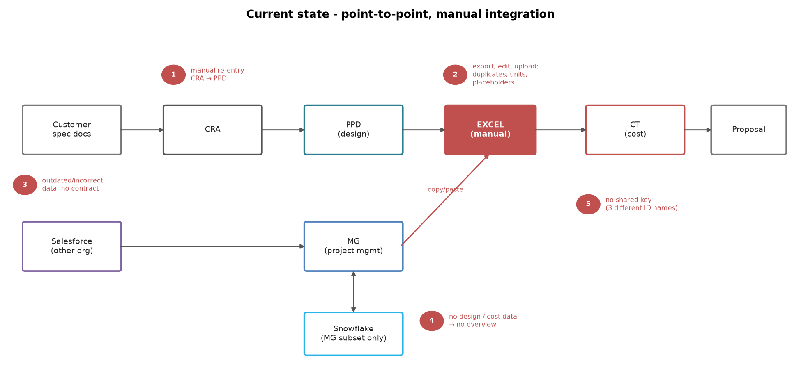
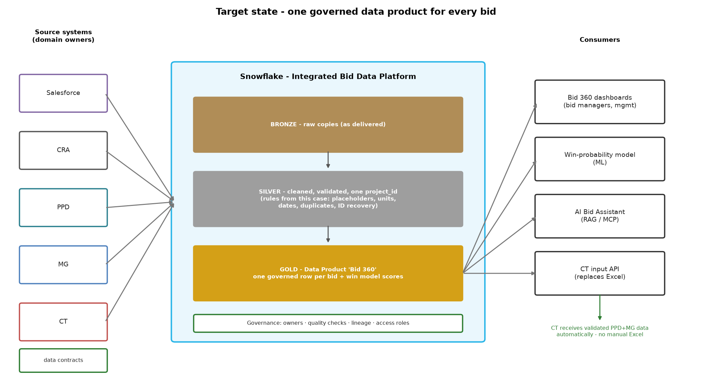

# Task 1 – Business Requirements and Data Product Design

**Integrated Bid Intelligence Platform: from scattered tools to one governed "Bid 360" data product**

---

## Executive summary

Bid data for large power plant projects is spread across six applications, joined by **manual Excel transfers**, with **no shared project key** and a data warehouse that sees **only a subset of one system**. The result is what users report: they can't find data, numbers don't match, upstream Salesforce data is unreliable, and the same data is typed several times.

The analysis of the PPD, CT and MG extracts (Task 2) shows these problems in the data itself: duplicate uploads, unit mix-ups, placeholder text, two date formats, 5 % of design records without an ID, and 15 % of projects missing from at least one system.

**Proposal:** build **"Bid 360"**, a governed data product on the existing **Snowflake** platform. It gives one trusted record per bid (requirements, design, cost, commercial context and outcome) with clear data owners, data contracts and automated quality checks. It replaces the manual Excel bridge with a validated feed to the Costing Tool and is the single source for dashboards, the win-probability model and an AI bid assistant.

---

## 1. Business problem analysis

### 1.1 Current landscape

Two disconnected flows:
- **Technical flow:** customer documents → CRA → PPD → **Excel (manual)** → CT → proposal
- **Commercial flow:** Salesforce (owned by another organisation) → MG ↔ Snowflake (MG subset only)

The flows meet only in an Excel file that a person fills, edits and uploads.

### 1.2 Main challenges, business risks and evidence

| # | Challenge | Evidence | Business risk |
|---|---|---|---|
| 1 | **No overview, data hard to find** (C1) | Data sits in 6 tools. Snowflake holds only part of MG and no design or cost data. 15 % of projects are missing from at least one system | Slow bid preparation, decisions on partial information, no portfolio view of win rates or margins |
| 2 | **Data differs across systems** (C2) | Duplicate records (CT 86, MG 56), 3 names for the same ID, unit and format differences | Wrong price in the proposal, so either **margin loss** or a lost bid. Rework and loss of trust in reports |
| 3 | **Salesforce data outdated or incorrect** (C3) | Salesforce is owned outside the organisation; no contract or validation on the feed into MG | Wrong customer and opportunity data spreads to MG, Excel, CT and Snowflake. Unreliable win/loss history (it is also the ML training label) |
| 4 | **Manual multiple entry** (C4) | Excel export → edit → upload; placeholders (`XX`, `N.A.`), mbar vs bar, two date formats | Error-prone, slow, not auditable, depends on key people |

**Overall risk profile:**
- **Financial:** mispriced bids, lost margin.
- **Commercial:** slower response to tenders, fewer bids submitted, lower win rate.
- **Operational:** heavy manual effort, dependence on key people.
- **Compliance:** no audit trail of what was changed in Excel before the cost calculation.
- **Strategic:** no trustworthy data for analytics or AI.

### 1.3 Root causes

The complaints are symptoms. Five root causes are behind them:

1. **Point-to-point integration with a human as middleware.** No interface between PPD/MG and CT; Excel is the integration layer.
2. **No common project identity.** Each system names and manages the project key differently, with no key-management rule (e.g. IDs can be missing in PPD).
3. **No data ownership or governance.** Nobody owns definitions (e.g. what "fuel type" means for a steam plant), units or quality, so problems aren't detected at the source.
4. **No data contract with upstream Salesforce.** The bid organisation consumes data it can't control, with no agreed fields, freshness or quality rules.
5. **The analytical platform is underused.** Snowflake exists, but only a subset of one system lands there, so there is no integrated, historical view.

---

## 2. Data product proposal: "Bid 360"

### 2.1 Purpose

> **One trusted, governed, always-current record of every bid, from customer requirements through design and cost to the outcome, available to every team and tool that needs it.**

It is built as a **data product**: it has an owner, defined consumers, documented quality, a stable interface and a lifecycle. It isn't a one-off data dump.

### 2.2 Business value

| Value | How |
|---|---|
| **Faster bids** | No manual Excel step; data flows once and is reused |
| **Fewer pricing errors** | Validated units, IDs and costs before CT calculates the price |
| **Transparency** | One overview of all bids, status, cost structure and outcome |
| **Better win rate** | Win/loss analytics and a win-probability score (Task 2: ROC-AUC ≈ 0.72; drivers are efficiency, region, customer and price at the same size) |
| **Trust and auditability** | Lineage and history: who changed what, and which source a value came from |
| **AI readiness** | Clean, linked data is the precondition for ML and GenAI assistants |

### 2.3 Producers and consumers

**Producers (source systems)**

| Source | What it provides | Domain owner (proposed) |
|---|---|---|
| Salesforce (via MG) | Customer, opportunity, tender conditions, outcome | Sales operations (external org, under a data contract) |
| CRA | Customer technical requirements | Proposal / requirements engineering |
| PPD | Plant design and site conditions | Plant engineering |
| CT | Cost estimate and bid value | Cost estimation |
| MG | Project, bid status, handover date | Bid management |

**Consumers**

| Consumer | Use |
|---|---|
| Bid managers | Bid overview, status, comparable past bids |
| Engineers and cost estimators | Reuse of past designs and costs; CT receives validated input automatically |
| Management | Pipeline, win rate, margin by region, plant type and customer |
| Data science | Win-probability model, cost benchmarking |
| AI Bid Assistant (RAG/MCP) | Natural-language questions, e.g. "similar CCGT bids in EU and their outcome" |

### 2.4 Data domains

| Domain | Content | Golden source |
|---|---|---|
| **Customer & Opportunity** | Customer, country, opportunity, tender conditions | Salesforce → MG |
| **Project** | Project ID, status, timeline, handover date | MG |
| **Technical Requirements** | Customer specifications | CRA |
| **Plant Design** | Plant type, output, efficiency, fuel, cooling, site conditions | PPD |
| **Cost & Bid** | Cost components, bid value, versions | CT |
| **Bid Outcome** | Win/loss, decision date, (future: competitor, reason) | MG / Salesforce |
| **Reference Data** | Region, country, plant type, units, fuel types | Data governance |

**Rule:** every attribute has **exactly one golden source**. Other systems may hold copies, but never edit them.

### 2.5 Target architecture

- **Ingestion:** automated feeds from every source (APIs or connectors) instead of manual exports.
- **Bronze:** raw copies as delivered (audit and replay).
- **Silver:** cleaned and validated, one `project_id`. The cleaning rules from Task 2 (placeholders, units, dates, duplicates, ID recovery) run here automatically.
- **Gold:** the **Bid 360** data product, one governed row per bid plus history, and win-probability scores.
- **Serving:** dashboards, ML, the AI assistant, and an **API that sends validated PPD + MG data to CT**, which removes the Excel step.

It builds on **Snowflake, which the organisation already uses**, so no new core platform is needed.

### 2.6 Governance strategy

| Element | What it means here |
|---|---|
| **Roles** | *Data product owner* (Bid Management) is accountable for Bid 360. *Domain owners* (engineering, costing, sales ops) own their data at the source. *Data stewards* maintain definitions and resolve quality issues |
| **Common key and master data** | One enterprise `project_id` created at opportunity start and used by every system. Customer master in Salesforce; reference lists (country, region, plant type, fuel) managed centrally |
| **Data contracts** | Agreed schema, units, allowed values, freshness and quality thresholds per source, **especially with Salesforce**. A breaking change is visible before it breaks reports |
| **Data quality rules** | Automated checks at ingestion: unique and non-null ID, units (bar), date format, allowed values, plausibility (efficiency by plant type, bid > cost), structural rules (ST has no GT cost) |
| **Monitoring** | Quality scorecard per source (completeness, uniqueness, linkability, freshness), as prototyped in Task 2. Issues are routed back to the owning domain |
| **Catalog and lineage** | Every field documented with definition, owner and source; lineage from proposal value back to source |
| **Security and access** | Role-based access (e.g. cost and margin data restricted); customer data handled per data-protection rules |
| **Lifecycle** | Versioning of designs and estimates per bid; history kept for analytics |

### 2.7 Business capabilities supported

1. **Bid overview and pipeline management:** a 360° view per bid and across the portfolio.
2. **Automated design-to-cost handover:** validated data from PPD + MG to CT, no Excel.
3. **Cost benchmarking:** compare a new estimate with similar historical plants.
4. **Win/loss analytics and win probability:** prioritise bids and review pricing.
5. **Knowledge reuse:** find comparable past bids, designs and lessons learned.
6. **Data quality management:** continuous measurement and feedback to sources.
7. **AI-assisted bid support:** a natural-language assistant on governed data.

### 2.8 Which problems it solves

| Complaint | Root cause | How Bid 360 solves it |
|---|---|---|
| **C1** Can't find data / no overview | Data scattered; warehouse only has part of MG | All domains integrated in one Gold product with a catalog; dashboards and an AI assistant on top |
| **C2** Data differs across systems | Manual transfer, no common key, copies edited in Excel | One `project_id`, one golden source per attribute, automated validation, no editable copies |
| **C3** Salesforce data outdated/incorrect | External owner, no contract or checks | Data contract (fields, freshness, quality), validation at ingestion, issue feedback to the Salesforce owner |
| **C4** Manual entry into multiple apps | Excel as integration layer | Enter once at the golden source; automated feeds and an API into CT |

### 2.9 How success is measured

| KPI | Example target |
|---|---|
| Bids with a complete 360° record (all domains linked) | 85 % today → > 98 % |
| Records passing quality checks at ingestion | > 99 % |
| Manual Excel transfers per bid | → 0 |
| Time from final design to cost calculation | measurable reduction |
| Data freshness (Salesforce → Bid 360) | ≤ 24 h |
| Adoption: active users of dashboards / assistant | growing quarter on quarter |

### 2.10 Roadmap

| Phase | Scope | Outcome |
|---|---|---|
| **1 – Foundation** (0–3 months) | Enterprise `project_id`; ingest PPD, CT, MG into Snowflake (Bronze/Silver); quality rules and scorecard; owners named | Visible, measured data quality; first integrated view |
| **2 – Data product** (3–6 months) | Gold "Bid 360"; Salesforce data contract; catalog and lineage; dashboards; CRA integration | One overview; trusted numbers |
| **3 – Automation** (6–9 months) | API from Bid 360 to CT replaces Excel | Manual re-entry removed |
| **4 – Intelligence** (9–12 months) | Win-probability model in production; cost benchmarking; AI Bid Assistant (RAG/MCP) | Faster, better-informed bid decisions |

**Key risks:**
- *Adoption:* users are used to Excel → involve key users early and replace Excel only once the new feed is trusted.
- *Salesforce dependency:* → escalate the data contract to the business owner.
- *Scope creep:* → deliver domain by domain.

### 2.11 Assumptions

1. Snowflake is the strategic data platform and can take more sources (licence and capacity available).
2. PPD, CT, MG and CRA can provide data via API, database access or scheduled exports. CT can accept automated input.
3. The Salesforce owner is willing to agree to a data contract, but the bid organisation can't change Salesforce itself.
4. `Project_ID`, `ID` and `Opportunity_ID` refer to the same business key (confirmed in Task 2).
5. MG receives a scheduled sync of selected Salesforce fields. Win/loss originates from the Salesforce opportunity status.
6. The data volume is moderate (thousands of bids), so the platform does not need big-data tooling beyond Snowflake.
7. Cost data is commercially sensitive and needs restricted access.
8. CRA output is structured enough to integrate; its documents could also be indexed for the AI assistant.
