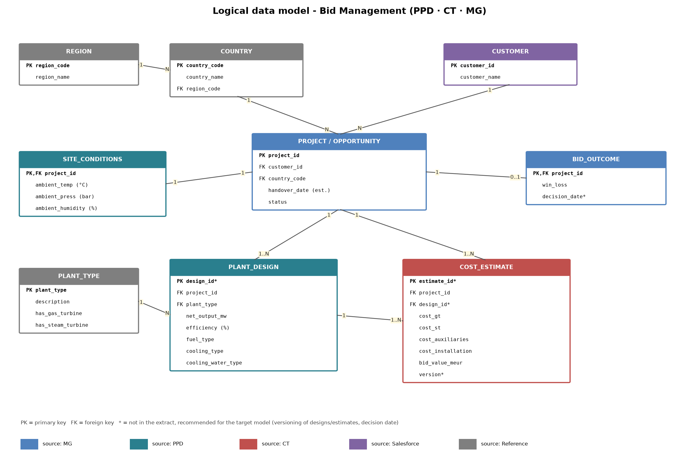

# Task 2 – Data Analysis and Machine Learning

**Bid Intelligence: data quality, data model and bid-success prediction**

> Code: `src/` (pipeline), `notebooks/01_eda.ipynb`, `notebooks/02_model.ipynb`.
> Every number in this report is produced by `python run_pipeline.py`.

---

## Summary

| Area | Result |
|---|---|
| Data quality | **7 findings**, each measured, fixed by a tested rule and linked to a user complaint |
| After cleaning | 100 % unique and 100 % linkable records in all three systems |
| ID recovery | 91 of 94 orphan design records re-linked; method validated at **100 % precision** |
| Integration | 2,000 projects; **1,699 (85 %)** exist in all three systems |
| Data model | 9 entities, each with one owning source system |
| Prediction | Logistic Regression, **ROC-AUC 0.72 (CV) / 0.79 (test)** vs 0.50 baseline |
| Win drivers | Plant efficiency, customer, country/region, plant size, bid value (price) |

---

## 1. Exploratory data analysis

### 1.1 The data

| System | Rows | Content | ID column |
|---|---|---|---|
| PPD – Power Plant Design | 1,880 | Plant type, output, efficiency, fuel, site conditions, cooling | `Project_ID` |
| CT – Costing Tool | 1,974 | Customer, region, cost components, bid value | `ID` |
| MG – Management Tool | 1,971 | Customer, country, output, bid value, handover date, **Win_Loss** | `Opportunity_ID` |

The same project key has **three different names**. Projects run from ID1000 to ID2999 (2,000 distinct IDs). Overall win rate: **59.5 %**.

### 1.2 Data quality findings

Each finding maps to a user complaint from Task 1:
C1 = cannot find data · C2 = data differs · C3 = Salesforce data wrong · C4 = manual entry.

| # | Finding | Evidence | Fix | Complaint |
|---|---|---|---|---|
| 1 | **Placeholder text instead of empty values** | `XX`, `N.A.`, `-`, `none`, `nan` in 11 columns, e.g. 216 in humidity, 148 in Cost_ST | Converted to real missing values; numeric columns typed explicitly | C4 |
| 2 | **Duplicate records** | CT: 86 duplicated rows; MG: 56. All are exact copies | Removed; unique key enforced | C2 |
| 3 | **Unit mix-up** | 329 ambient-pressure values in mbar (~1000) instead of bar (~1.0) | Values > 10 divided by 1000; range-checked afterwards | C4 |
| 4 | **Missing project IDs** | 94 PPD rows (5 %) have no ID and cannot be linked | Recovered 91 by unique match on output + plant type + region (see 1.3); 3 removed | C1 |
| 5 | **Mixed date formats** | Handover date as `21.11.2022` (138) and `2026-10-04` (551) | Both formats parsed explicitly, no guessing between day and month | C4 |
| 6 | **"Missing" costs that are not missing** | Cost_GT empty for 100 % of ST plants; Cost_ST empty for 100 % of SCGT plants | Set to 0 (structural: the plant has no such turbine). Only 75–104 truly missing costs per component remain | — |
| 7 | **Fields without an owner** | Fuel type never filled for ST plants and only ~50 % for gas plants | Explicit `Unknown` category; needs a definition and owner | C1 |

Further observations:
- **Values sitting exactly on a maximum**: 45 Cost_GT = 200, 68 Cost_ST = 100, 27 auxiliaries = 250. This looks like capping or default values and should be checked with the CT owner.
- **2 implausible humidity values** (exactly 0 %) were set to missing.
- **Efficiency is plausible** for every plant type (CCGT 50–63 %, SCGT 20–45 %, ST 23–40 %). The check passed.

### 1.3 ID recovery and how it was validated

Design (PPD) and cost (CT) data describe the same plant. For all linked projects, output (MW), plant type and region agree **100 %**, so together they act as a fingerprint.

Rule: an orphan PPD row gets an ID only if **exactly one** unused CT project matches, and that project matches **only one** orphan. Ambiguous cases are never guessed.

**Validation:** in a simulation, 470 *known* IDs were blanked out and recovered. 445 were restored, **all 445 correctly (100 % precision)**, and the 25 ambiguous rows were correctly left alone.

### 1.4 Before / after scorecard

| System | Completeness | Uniqueness | Linkability |
|---|---|---|---|
| PPD | 91.5 % → 92.0 % | 100 % → 100 % | **95.0 % → 100 %** |
| CT | 92.8 % → **98.3 %** | **91.3 % → 100 %** | 100 % → 100 % |
| MG | 90.3 % → 91.5 % | **94.3 % → 100 %** | 100 % → 100 % |

Completeness rises only modestly because most remaining gaps are genuinely unknown values. The pipeline does not invent data; imputation happens only inside the ML pipeline.

### 1.5 Integration across systems

- **15 % of projects are missing from at least one system.** No single system has the full picture, which explains complaint C1.
- **Consistency:** where the same attribute is stored in two systems (customer, bid value, plant type, region, output), the values agree **100 %** once records are correctly linked.

**Interpretation:** in this extract, "data differs across systems" (C2) is caused by **duplicates, missing keys, placeholders, unit and format differences**, i.e. by the manual Excel transfer process, not by conflicting master data. Complaint C3 (Salesforce) can't be tested directly because no Salesforce extract was provided. It does matter, though, because the target label `Win_Loss` probably comes from Salesforce (see the assumptions in section 2).

### 1.6 Characteristics of the data

- **Plant type:** CCGT wins 73 %, SCGT 48 %, ST 49 %.
- **Region:** EU 70 %, AM 56 %, APAC 49 %. Highest win rates by country: United States 78 %, Germany 71 %. Lowest: Mexico 34 %.
- **Customer:** Aregion 71 % vs Chicho 44 %.
- **Efficiency:** won bids have higher efficiency within each plant type.
- Bid value grows roughly linearly with plant size, and every bid is above its estimated cost (bid/cost ratio 1.05–2.35).

---

## 2. Logical data model

### Entities

| Entity | Key attributes | Source (owner) |
|---|---|---|
| **PROJECT / OPPORTUNITY** | project_id (PK), customer_id, country_code, handover_date | MG |
| **CUSTOMER** | customer_id (PK), customer_name | Salesforce → MG |
| **COUNTRY** / **REGION** | country_code → region_code | Reference data |
| **SITE_CONDITIONS** | project_id (PK/FK), ambient temp, pressure (bar), humidity | PPD |
| **PLANT_DESIGN** | design_id, project_id, plant_type, net_output_mw, efficiency, fuel, cooling | PPD |
| **PLANT_TYPE** | plant_type (PK), has_gas_turbine, has_steam_turbine | Reference data |
| **COST_ESTIMATE** | estimate_id, project_id, design_id, 4 cost components, bid_value_meur | CT |
| **BID_OUTCOME** | project_id (PK/FK), win_loss, decision_date | MG (Salesforce) |

### Relationships

- A customer has many projects (1 : N). A region has many countries, and a country has many projects (1 : N).
- A project has exactly one site (1 : 1) and zero or one outcome (1 : 0..1).
- A project has one or more plant designs, and a design has one or more cost estimates (1 : 1..N).
- A plant type classifies many designs (1 : N).

### Assumptions

1. `Project_ID`, `ID` and `Opportunity_ID` are the **same business key**. This is confirmed by the 100 % attribute agreement.
2. In the extract, each project has **one** design and **one** cost estimate. In reality there are revisions during a bid, so the target model adds `design_id`, `estimate_id` and `version` (marked * in the diagram).
3. **Customer** is master data owned by Salesforce, and MG only holds a copy.
4. **Win_Loss** is recorded in MG and probably originates from Salesforce opportunity status (*Closed Won/Lost*).
5. **Region** is derived from country. Mapping: EU = DE, ES, FR, IT, NL; AM = US, CA, MX, BR, CL; APAC = IN, ID, JP, AU, TH.
6. Site conditions belong to the project location, not to a design variant.
7. Cost values are in M€ like the bid value (the unit is not stated in the source).
8. `PLANT_TYPE` carries the rule "which turbines exist", which is what makes structural zero costs explicit.

---

## 3. Predicting bid success (Win_Loss)

### 3.1 Data preparation

1. **Input:** the cleaned and integrated *Bid 360* table, one row per project (1,915 projects with a known outcome).
2. **Only information known at bid time is used**, so the model can't "cheat".
   - Leakage check: `handover_date` is filled for 36 % of won and 36 % of lost bids, so it reveals nothing about the outcome.
3. **Engineered features:**
   - `bid_to_cost_ratio`: implied margin
   - `bid_per_mw`: price per MW
   - `share_*`: share of each cost component in the total
   - `handover_year`, `has_handover_date`
4. **Preprocessing** happens inside a scikit-learn pipeline, fitted on training data only:
   - numbers: median fill, plus a "was missing" indicator, then scaling
   - categories: `Unknown`, then one-hot encoding
5. **Excluded:** `project_id` (an identifier), data-quality flags, and system-coverage flags.

### 3.2 Model selection

| Model | Why it was tried |
|---|---|
| Dummy (always "win") | Reference point: any useful model must beat 59.5 % accuracy and 0.50 AUC |
| **Logistic Regression** | Simple, robust on ~1,900 rows, and fully explainable (each feature has a direction and weight) |
| Random Forest | Captures non-linear effects and interactions |
| Gradient Boosting | Usually the strongest model on tabular data |

**Evaluation design:** an 80/20 stratified split. Models are compared with **5-fold cross-validation** on the 80 %, and the final check uses the untouched 20 %. **ROC-AUC** is the main metric because it measures ranking quality independent of a threshold and isn't distorted by the 60/40 class balance.

### 3.3 Performance

**Cross-validation (training set, mean ± std):**

| Model | ROC-AUC | Accuracy | Precision | Recall | F1 |
|---|---|---|---|---|---|
| **Logistic Regression** | **0.722 ± 0.007** | 0.692 | 0.721 | 0.788 | 0.753 |
| Gradient Boosting | 0.711 ± 0.013 | 0.674 | 0.702 | 0.786 | 0.741 |
| Random Forest | 0.709 ± 0.020 | 0.678 | 0.695 | 0.820 | 0.752 |
| Dummy baseline | 0.500 | 0.595 | 0.595 | 1.000 | 0.746 |

**Test set (383 unseen bids):**

| Model | ROC-AUC | Accuracy | Precision | Recall | F1 |
|---|---|---|---|---|---|
| **Logistic Regression** | **0.790** | **0.723** | 0.736 | 0.833 | 0.782 |
| Random Forest | 0.769 | 0.695 | 0.713 | 0.816 | 0.761 |
| Gradient Boosting | 0.765 | 0.697 | 0.726 | 0.789 | 0.756 |

**Selected: Logistic Regression.** It has the best and most stable cross-validated score, and it is the easiest to explain to the business. The more complex models did not improve on it, which suggests the relationships in this data are mostly simple.

The test score (0.79) is higher than the cross-validation score (0.72). With only 383 test rows some variation is expected, so **~0.72 is the more reliable estimate**.

### 3.4 What drives a win?

| Driver | Effect (Logistic Regression) | Business reading |
|---|---|---|
| **Efficiency** | strongest positive | Technically better plants win more often |
| **Customer** | Aregion +, Chicho − | Relationship / customer-specific patterns |
| **Country / region** | US, EU +; Mexico, Thailand, India − | Market strength differs strongly |
| **Plant size** | + | Larger projects are won more often |
| **Bid value at the same size** | − | **Price sensitivity:** a more expensive offer for the same plant lowers the chance to win |
| Ambient temperature | − | Hot sites are harder to win (performance derating) |

Plant type isn't in the top list because its effect is already captured by efficiency (CCGT = high efficiency).

### 3.5 Limitations and next steps

- **Small dataset** (~1,900 bids) and **no competitor, pricing-strategy or timing data**. These are usually the strongest drivers of bid success.
- **Label quality:** Win_Loss depends on timely Salesforce/MG updates (C3).
- **Correlation, not causation:** the model shows patterns, not reasons.
- Next steps: add competitor and price-position data, do time-based validation (train on older bids, test on newer ones), calibrate probabilities, and retrain regularly from the governed data product.
- **Intended use:** a win-probability score that helps **prioritise bid effort and review pricing**, not an automatic go/no-go decision.
